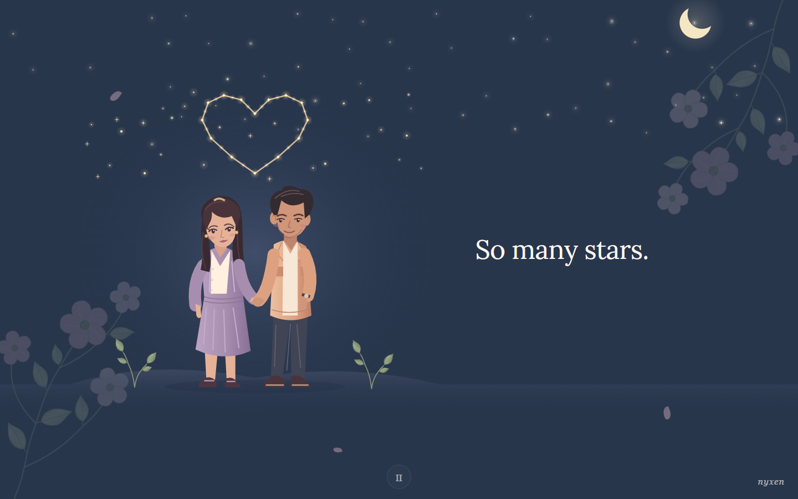
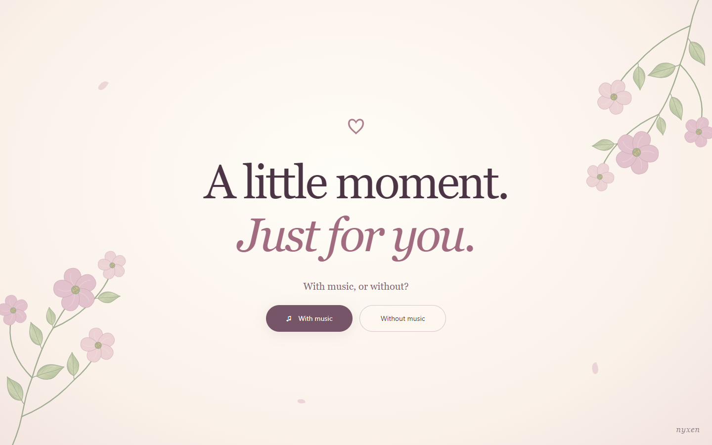
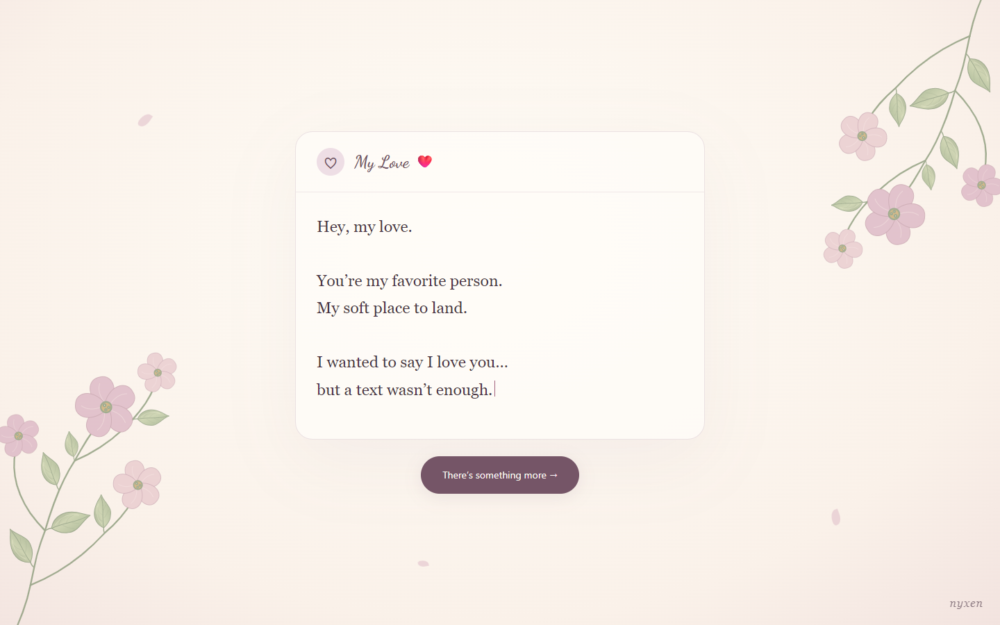
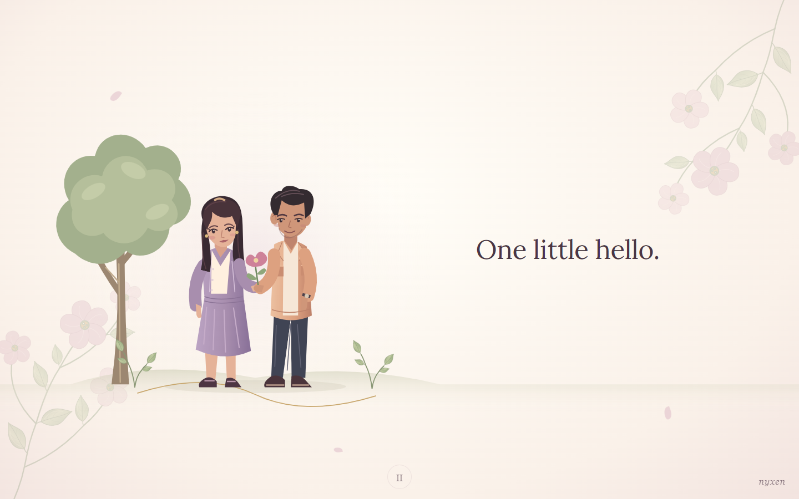

<div align="center">

# Confession ♡

**An interactive love letter. A little moment, just for your favorite person.**

Soft flowers, quiet music, and a sky full of stars that slowly becomes a heart.

[](https://lovingpartner.vercel.app)

[](https://react.dev/)
[](https://www.typescriptlang.org/)
[](https://vite.dev/)
[](https://gsap.com/)

**[Visit the website](https://lovingpartner.vercel.app) · [Report an issue](https://github.com/kharalnirmal/Confession/issues)**

</div>

[](https://lovingpartner.vercel.app)

## A small story. An infinite kind of love.

Confession is a small, personal web experience that turns “I love you” into something you can watch unfold. It begins with a message that almost stayed a draft, then moves through five illustrated chapters—from a first hello to the comfort of simply being together.

No account. No form to fill out. Just open it, choose music or quiet, and enjoy the moment.

## A peek inside

| Just for you | A message from the heart |
| :---: | :---: |
|  |  |



*Screenshots captured from the application, not design mockups.*

## The little details

- **Five illustrated chapters** — a first hello, everyday moments, a starry sky, an embrace, and a quiet ending.
- **A letter-like opening** — a typed message addressed to **My Love ❤️**, followed by a gentle reveal.
- **Stars that tell a story** — a smooth line draws from the bottom through each star to close a heart, then glows softly above the couple. Varied stars fill the sky from left to right.
- **Rain worth staying for** — layered rainfall, umbrella drips, irregular reflective puddles, overlapping ripples, and tiny splashes.
- **A living garden** — butterflies beside the welcome message and warm yellow-green fireflies drifting near the ground at night.
- **Flowers with a breeze** — connected stems, shaded leaves, fine veins, and softly swaying blossoms.
- **A day-to-night palette** — warm cream and dusty pink transition into moonlit blue.
- **Optional background music** — choose music or silence; pause and replay the story.
- **Made for smaller screens too** — responsive layouts with less crowded stars on mobile.
- **Considerate motion** — respects reduced-motion preferences and pauses playback when the tab is hidden.

## Run it locally

Use **Node.js 24 LTS** and npm.

```bash
git clone https://github.com/kharalnirmal/Confession.git
cd Confession
npm ci
npm run dev
```

Open the local URL printed by Vite.

| Command | Purpose |
| --- | --- |
| `npm run dev` | Start the development server |
| `npm run build` | Type-check and create the production build in `dist/` |
| `npm run preview` | Serve the production build locally |
| `npm run lint` | Run ESLint |
| `npm test` | Run story timing, character motion, constellation, rain, and asset tests |

## Make it yours

| What to change | Where to look |
| --- | --- |
| Chapter titles and on-screen lines | [`src/content/story.ts`](src/content/story.ts) |
| Opening message and recipient name | [`src/components/MessageOpening.tsx`](src/components/MessageOpening.tsx) |
| Welcome screen and music controls | [`src/App.tsx`](src/App.tsx) |
| Final page and social links | [`src/components/EndingSequence.tsx`](src/components/EndingSequence.tsx) |
| Colors, typography, layout, and transitions | [`src/App.css`](src/App.css) |
| Floral borders and leaves | [`FloralFrame.tsx`](src/components/FloralFrame.tsx) and [`BotanicalLeaf.tsx`](src/components/BotanicalLeaf.tsx) |
| Full-width stars, moon, and fireflies | [`src/components/NightSky.tsx`](src/components/NightSky.tsx) |
| Heart constellation geometry and timing | [`SkyConstellation.tsx`](src/components/SkyConstellation.tsx) and [`constellation.ts`](src/lib/constellation.ts) |
| Rain, puddles, and splashes | [`RainGarden.tsx`](src/components/RainGarden.tsx) and [`rain.ts`](src/lib/rain.ts) |
| Welcome butterflies | [`src/components/ButterflyAccent.tsx`](src/components/ButterflyAccent.tsx) |
| Illustrated scenes | [`src/components/StoryIllustration.tsx`](src/components/StoryIllustration.tsx) |
| Story pacing | [`src/hooks/useStoryPlayback.ts`](src/hooks/useStoryPlayback.ts) |
| Soundtrack URL and cue metadata | [`src/content/cueSheet.ts`](src/content/cueSheet.ts) |

The app is a static React frontend: no backend or environment variables are required for the current experience. Google Fonts supplies Lora and Dancing Script, with local font fallbacks.

## Deploy

The live experience is at **[lovingpartner.vercel.app](https://lovingpartner.vercel.app)**.

For Vercel, import this repository and use:

| Setting | Value |
| --- | --- |
| Framework preset | Vite |
| Install command | `npm ci` |
| Build command | `npm run build` |
| Output directory | `dist` |

For another static host, upload the **entire `dist/` folder**, including `music/`. When deploying under a subpath, configure Vite's `base` before building; the soundtrack URL uses `import.meta.env.BASE_URL`.

### A note about music

The supplied recording is packaged as a **64 kbps AAC-LC `.m4a`** with fast-start metadata. At approximately **1.11 MB**, it is about **48% smaller** than the original and is included in production builds.

**Packaging is not music licensing.** Obtain the appropriate rights before publicly hosting or synchronizing any recording. To reuse this project, replace the soundtrack with music you own or are licensed to use. See [soundtrack packaging notes](docs/music-preview.md) for details.

---

<div align="center">

Made with care by **[Nirmal Kharal](https://github.com/kharalnirmal)** · *nyxen*

**One little hello. And then, there was you.**

</div>
